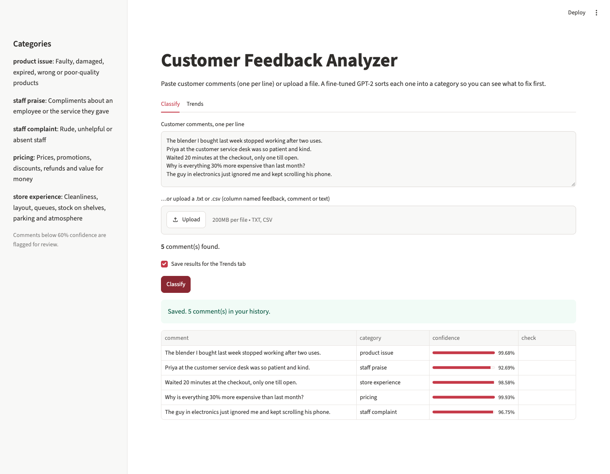
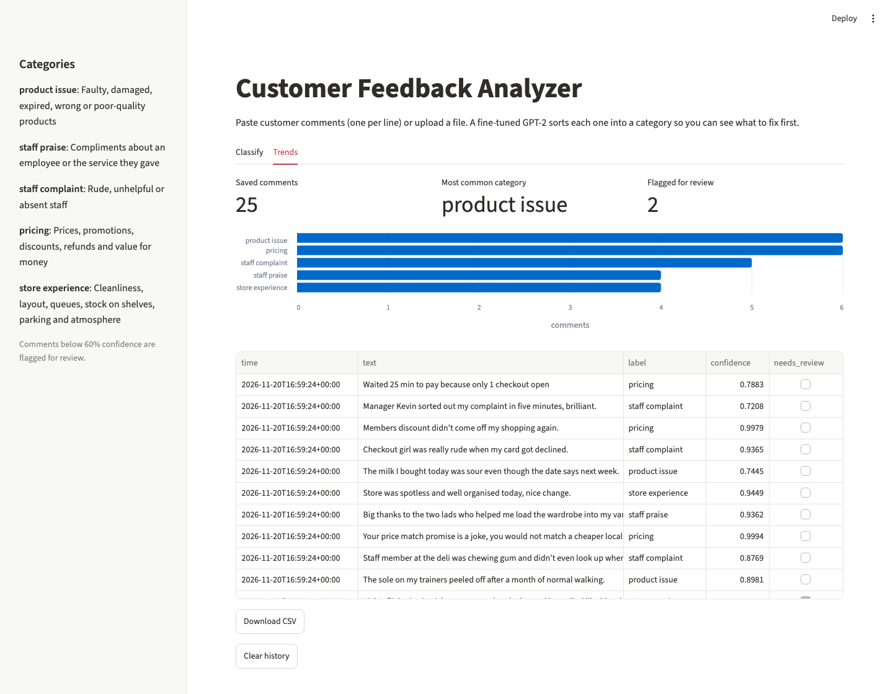

# Customer Feedback Analyzer

[](https://github.com/Subhash-2910/customer-feedback-analyzer/actions/workflows/ci.yml)
[](https://ask.thili.ai/b/smdebx95x5)

Retail managers paste or upload customer comments and get each one sorted into one of five categories:
**product issue, staff praise, staff complaint, pricing, store experience**. A Trends tab counts the saved
comments per category, so the most common problem is easy to spot.

The classifier is GPT-2 (124M) fine-tuned with the Hugging Face `Trainer` to **generate a special category
token** after the comment, for example `Category: <|staff_complaint|>`. It runs on a laptop and needs no API key.

| Classify | Trends |
|---|---|
|  |  |

## Results

Tested on comments the model never saw during training ([results/metrics.md](results/metrics.md)):

- **held-out:** 100 generated comments (20 per category). They use only phrasings that were kept out of training.
- **hand-written:** 20 realistic comments, written separately and labelled before any model was run on them.
  They add slang, prices, names and new situations.

| system | held-out accuracy | held-out macro-F1 | hand-written accuracy | hand-written macro-F1 |
|---|---|---|---|---|
| majority class (always the same label) | 20% | 0.07 | 20% | 0.07 |
| zero-shot GPT-2 (same prompt, no fine-tuning) | 19% | 0.09 | 20% | 0.08 |
| keyword rules ([app/baselines.py](app/baselines.py)) | 69% | 0.72 | 60% | 0.53 |
| **fine-tuned GPT-2 (this project)** | **92%** | **0.92** | **85%** | **0.85** |

- The fine-tuned model **generates a category token 100% of the time**, even with no restriction on its output.
- It takes 10–25 ms per comment on a laptop CPU. Training takes 27 s on an Apple M3 GPU
  ([results/training.json](results/training.json)).
- Mean confidence is 0.89 when it is right and 0.75 when it is wrong. Predictions below 60% confidence are
  flagged for a person to check.
- [results/samples.md](results/samples.md) lists every hand-written prediction and every held-out mistake.
- [results/sweep.md](results/sweep.md) shows the other training settings tried (2, 4 and 8 epochs, and two
  learning rates). Two epochs are too few (79%). From 4 epochs on, the results differ by only a few comments.

## How it works

| milestone | file | what it does |
|---|---|---|
| 1. Dataset | [app/dataset.py](app/dataset.py) | 5 categories, 12 hand-written phrasings each, with slots for products, staff names and departments, plus openers, closers and noise. **300 train / 100 test** comments ([dataset/](dataset/)). The last 3 phrasings of each category appear only in the test set. |
| 2. New tokens | [app/model.py](app/model.py) | Adds `<\|product_issue\|>` … `<\|store_experience\|>` to the GPT-2 tokenizer and resizes the embeddings. Each new row starts at the mean embedding of the category's words. Training text is `Customer feedback: … \nCategory: <\|label\|><\|endoftext\|>`, and the prompt is masked so the loss counts only the label token and EOS. |
| 3. Fine-tuning | [app/train.py](app/train.py) | Hugging Face `Trainer`, 4 epochs, lr 5e-5, batch 16, 10% validation split. Validation loss goes from 0.96 to 0.05. |
| 4. Inference | [app/classify.py](app/classify.py) | `classify(text)` runs the prompt and reads the next-token distribution. It returns the most likely category token, its probability among the 5 categories (the confidence), every category's score, and the token the model would generate with no restriction. [app/evaluate.py](app/evaluate.py) compares it with the baselines. |
| 5. App | [app/main.py](app/main.py), [app/feedback.py](app/feedback.py) | Streamlit: paste comments or upload a `.txt`/`.csv`, then see the category, a confidence bar and a review flag for each one. Results are saved to `data/app.json`. The Trends tab shows counts per category and has a CSV download. |

## Run it

You need Python 3.11 or 3.12 and git. About 2.5 GB of disk is used for PyTorch, GPT-2 and the trained model.

```bash
git clone https://github.com/Subhash-2910/customer-feedback-analyzer.git
cd customer-feedback-analyzer
make setup        # python3 -m venv .venv && .venv/bin/pip install -r requirements.txt
make all          # dataset -> fine-tune (downloads GPT-2 once) -> evaluate; rewrites results/
make app          # open http://localhost:8501
```

`make all` is the one command that rebuilds everything. The fine-tuned model (478 MB) is not in git, so it is
rebuilt in `model/feedback-gpt2`. That takes under a minute on Apple-silicon or CUDA GPUs and a few minutes on
CPU. To classify from the command line:

```bash
.venv/bin/python -m app.classify "The cashier was rude to me" "Why is milk so expensive now?"
```

Optional settings (`MODEL_DIR`, `DATA_PATH`) are in [.env.example](.env.example).

**Tests:** `make test` (or `pytest`). The 24 tests build a tiny GPT-2 and tokenizer offline, so they take
seconds and download nothing. They run on every push in GitHub Actions.

**Docker** (optional): `docker build -t feedback . && docker run -p 8080:8080 feedback`. The image trains the model
during the build. This Dockerfile was not built locally because the development laptop didn't have enough disk
space. CI runs the tests, not the Docker build.

## Limits

- **The training data is synthetic.** It comes from 45 training phrasings written by one person. Real customer
  feedback is longer, messier and often mentions several things at once. Expect lower accuracy on real data
  until the model is fine-tuned on some of it.
- **One label per comment.** "The cashier was rude and the kettle was broken" gets only one of the two categories.
- **The test sets are small.** On the hand-written set, one comment is 5 percentage points. The held-out set
  reuses the training slots (product names, staff names), so it tests new phrasings, not new vocabulary.
- **Known mistakes** ([results/samples.md](results/samples.md)):
  - "walked off halfway through helping me" is labelled staff praise, misled by the word *helping*.
  - "self-checkout machines out of order" is labelled product issue.
  - "Manager Kevin sorted out my complaint … brilliant" is labelled staff complaint, misled by the word *complaint*.
  - "only 1 checkout open" is labelled pricing.
- **Confidence is a model probability, not a calibrated guarantee.** Wrong answers still average 75% confidence,
  so the 60% review flag catches only some mistakes.
- **English (UK retail wording) only.** The keyword baseline was written by hand from the training phrasings.
  Words that appear only in the test sets were left out on purpose, so the baseline isn't tuned on the test.

## Project layout

```
app/        dataset.py  model.py  train.py  classify.py  baselines.py  evaluate.py  feedback.py  storage.py  main.py
dataset/    train.jsonl  test.jsonl                       (made by app/dataset.py)
results/    metrics.md/.json  samples.md  sweep.md  training.json  screenshots/
tests/      one test file per milestone + conftest.py (tiny offline GPT-2)
Makefile    setup / all / app / test        Dockerfile    .github/workflows/ci.yml
```

## Milestones

- [x] **1. Define 3-5 feedback categories and create a small dataset of example comments with labels.**
- [x] **2. Extend GPT-2 tokenizer and model with new category tokens.**
- [x] **3. Fine-tune the model using the Hugging Face Trainer.**
- [x] **4. Implement an inference function to classify new feedback.**
- [x] **5. Build a simple Streamlit app to input comments and show classifications.**

Stretch ideas done: a confidence score for each classification, saving classified comments for later review
(with CSV export), and a trends view.
